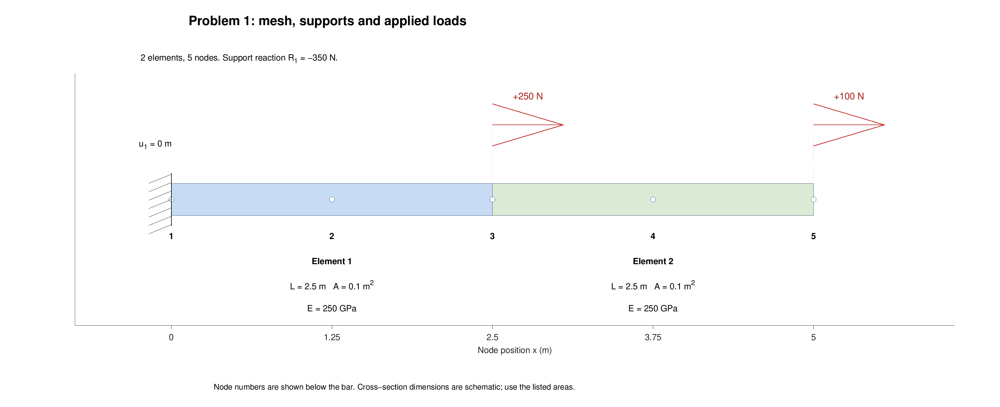
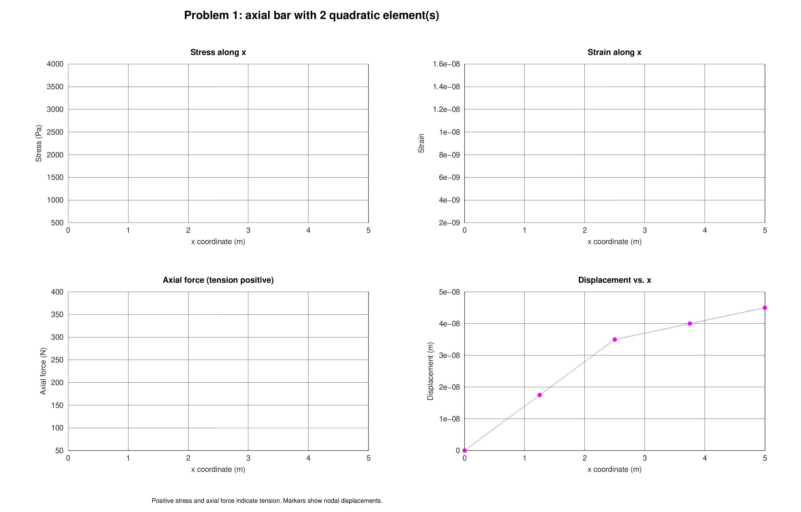

# 1D Bar Finite Element Solver in MATLAB

Calculate displacement, support reactions, strain, stress and axial force in a
straight bar using three-node quadratic finite elements. Enter the bar properties
and boundary conditions in the Excel workbook, then run the MATLAB script.

## Quick start

**Requirements:** MATLAB R2021a or later. No additional MATLAB toolboxes or
Microsoft Excel installation are required to run the solver.

1. Download or clone this repository. Extract the files if you downloaded a ZIP.
2. Keep `FEA_2nd_order_solver.m` and `Nodal data-WPS Office.xlsx` in the same folder.
3. Open [FEA_2nd_order_solver.m](FEA_2nd_order_solver.m) in MATLAB and click **Run**.
4. Enter `1` to solve the first example. Enter `2`, `3` or `4` for the other examples.

Alternatively, set MATLAB's Current Folder to this repository and enter:

```matlab
run('FEA_2nd_order_solver.m')
```

The script displays a results table and four plots: stress, strain, axial force
and displacement. It saves these files for problem 1:

```text
results/
  problem1.xlsx     Nodal results in the "Nodal results" sheet
  problem1.csv      The same results table in CSV format
  problem1.png      The four plots in one image
```

Other problems use their selected ID in the filenames. Re-running a problem
replaces its previous outputs. The input workbook is not overwritten.

The script clears the MATLAB workspace at the start. After it finishes, arrays
such as `K`, `D`, `F`, `Reaction` and the results table `T` remain in the workspace.

## Set up your own bar

Open [Nodal data-WPS Office.xlsx](Nodal%20data-WPS%20Office.xlsx) in a spreadsheet
editor. There are two sheets: **`Nodal data`** and **`Boundary condition`**.
Each problem needs one row in each sheet, using the same positive integer
`problemID`.

### 1. Choose the mesh and units

Number the nodes from left to right. Each element has a left node, a middle node
and a right node. The middle node lies halfway along the element:

```text
Element 1: nodes [1, 2, 3]
Element 2: nodes [3, 4, 5]
Element 3: nodes [5, 6, 7]
```

Adjacent elements share an end node, so **`n_nodes = 2*n_elem + 1`**. The solver
calculates node coordinates from the element lengths, starting at `x = 0`.

| Input or output | Unit |
| --- | --- |
| Length and displacement | m |
| Cross-sectional area | m² |
| Young's modulus and stress | Pa (N/m²) |
| Force and reaction | N |
| Strain | Dimensionless |

Use these units consistently. For example, 250 GPa is `250e9` Pa, 100 mm is
`0.1` m, and 100 mm² is `0.0001` m². Positive loads and displacements act along
+x. Positive strain, stress and axial force indicate tension.

### 2. Fill in `Nodal data`

| Column | What to enter |
| --- | --- |
| `problemID` | A unique positive integer for the problem |
| `n_elem` | Number of elements |
| `n_nodes` | Total nodes: `2*n_elem + 1` |
| `L1`, `L2`, … | Length of each element, in m |
| `E1`, `E2`, … | Young's modulus of each element, in Pa |
| `A1`, `A2`, … | Cross-sectional area of each element, in m² |

Lengths, areas and elastic moduli must be positive and finite. Use numeric values
such as `250e9`. Expressions stored as text, such as `250*10^9`, are not accepted.
Different elements may have different properties.

### 3. Fill in `Boundary condition`

For every node k, fill in both `Dk_known` and `DFk`. Follow this flag convention:

| `Dk_known` | Meaning of `DFk` | What the solver finds |
| --- | --- | --- |
| `0` | Prescribed displacement, in m | Support reaction |
| `1` | Applied nodal force, in N | Displacement |

Common entries are:

| Condition at node k | `Dk_known` | `DFk` |
| --- | --- | --- |
| Fixed node | `0` | `0` |
| Unloaded node with unknown displacement | `1` | `0` |
| Applied force of +250 N | `1` | `250` |
| Prescribed displacement of +1 mm | `0` | `0.001` |

Prescribe at least one displacement to prevent rigid-body motion. Do not leave
active nodes blank, even when their applied force is zero. Each node specifies
either displacement or force through this input format.

### 4. Save and run

To add a problem, append a row to each sheet and give both rows the same new ID.
Add more property or boundary-condition columns if the mesh needs them. Unused
columns beyond that problem's element and node counts may remain blank.

Save the workbook, run the script, and enter the new ID when prompted. No changes
to the MATLAB code are needed to select a new problem.

## Worked example: problem 1

This case is already included in the workbook with `problemID = 1`,
`n_elem = 2` and `n_nodes = 5`. Both elements have length `2.5 m`, area
`0.1 m²` and Young's modulus `250e9 Pa`.

| Node k | Position (m) | `Dk_known` | `DFk` |
| --- | --- | --- | --- |
| 1 | 0 | 0 | 0 |
| 2 | 1.25 | 1 | 0 |
| 3 | 2.5 | 1 | 250 |
| 4 | 3.75 | 1 | 0 |
| 5 | 5 | 1 | 100 |

In the workbook, enter each node's flag/value pair under its corresponding
headers: `D1_known`, `DF1`, `D2_known`, `DF2`, and so on. The positions above are
for reference; coordinates are calculated automatically.



For this example, the displacement at node 5 should be approximately **4.5e-8 m**
and the reaction at node 1 should be **-350 N**. The negative sign means the
reaction acts along the negative x direction.



## Read the outputs

The XLSX and CSV tables contain one row per global node:

| Column | Meaning |
| --- | --- |
| `Element`, `Node`, `x_m` | Element index, node number and position |
| `Displacement_m` | Calculated or prescribed axial displacement |
| `AppliedForce_N` | Load entered at a force-specified node |
| `ReactionForce_N` | Reaction at a displacement-specified node; zero elsewhere |
| `NodalForce_N` | Assembled nodal force `K*D`, including support forces |
| `Strain_L`, `Strain_R` | Strain on the left and right sides of the node |
| `Stress_L_Pa`, `Stress_R_Pa` | Stress on the left and right sides of the node |

Left/right values can differ where two elements meet. At either end of the bar,
both columns repeat the only available side. The `Element` column assigns a
shared node to the element on its right; the last node belongs to the last element.

The axial-force plot shows **`A*stress` inside each element**. It is different
from the nodal-force column, which represents the assembled equilibrium equations.
Applied loads plus reactions should sum to approximately zero. Tiny values close
to zero can be floating-point residuals.

## Other supplied examples

| ID | Bar model | Loading diagram | Result plots |
| --- | --- | --- | --- |
| 1 | Uniform bar, two elements | [View](pictures/problem1_model.png) | [View](pictures/problem1_results.png) |
| 2 | Uniform bar, one element with a middle-node force | [View](pictures/problem2_model.png) | [View](pictures/problem2_results.png) |
| 3 | Two elements with different areas | [View](pictures/problem3_model.png) | [View](pictures/problem3_results.png) |
| 4 | Three elements with different areas | [View](pictures/problem4_model.png) | [View](pictures/problem4_results.png) |

Bar thickness in the loading diagrams is schematic; use the labeled areas.

## Model limits

Use this solver for a straight bar with small axial displacements, linear elastic
material behavior, constant properties within each element, and nodal loads.
It does not model bending, distributed loads, thermal strain or plasticity.

To resolve the change in displacement slope caused by a point load, place the load
at an element boundary. Problem 2 uses a middle-node point load within one element,
so its quadratic displacement field is an approximation to that local behavior.

## Troubleshooting

| Problem | What to check |
| --- | --- |
| Workbook cannot be found | Keep the workbook beside the script and retain its exact filename. |
| Problem ID is rejected | Use a positive integer appearing exactly once in each input sheet. |
| Missing column or invalid value | Check headers, numeric properties and every active node's flag/value pair. |
| Node-count error | Set `n_nodes = 2*n_elem + 1`. |
| Unrestrained or badly conditioned system | Check prescribed displacements, units and positive element properties. |
| Cannot save a result file | Close that output file in your spreadsheet editor and check folder permissions. |
